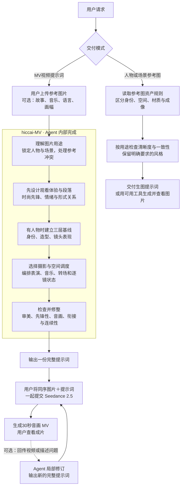

# hiccai-MV · 使用指南

上传参考图片，可附一句创意，即可获得一份与图片一起提交给 Seedance 2.5 的30秒音乐 MV 完整提示词。Agent 负责分镜、表演、音乐、歌词、转场与连续性设计；视频由用户在生成平台制作。

也支持明确请求 MV 人物与场景参考图或生图提示词；实际图片需要所在 Agent 有合适生图工具。图像资产按独立模式交付，不强制附带视频分镜、音乐与歌词。

所有创作输出必须兼具时尚表达与先锋创意，包括单场景和修订。Agent 会从图片的廓形、材质、姿态和空间关系建立时尚表达，以相互关联的形式选择组织全片；无需用户填写额外分析表。时尚与先锋可以克制、温暖或粗粝，不固定为冷感、奢华、霓虹或高速特效，也不要求每镜都出现实验效果。

创作时先决定观看体验与段落，再选择摄影和调度。可以指定导演风格、主观视角、群体站位、长镜头或固定机位；Agent 会转成具体画面与运动关系，保留有效的静止、留白和反差，不用技法数量代替表现力。

涉及人物时，Agent 会按身份、造型和镜头表现三层管理。已有参考人物优先保持身份与锁定造型；只有明确允许原创或修改时，才设计相应结构与妆发服饰。展示名称为 `hiccai-MV`，Skill 调用标识为 `$hiccai-mv`。

## Skill 架构与使用路径

## 第一次使用

如果 Skill 已安装并在当前会话可用，上传图片后发送：

> 使用 $hiccai-mv，根据这些图片创作30秒音乐 MV，给我可直接与图片一起提交 Seedance 2.5 的完整提示词。其余创作设定你来决定。

也可以附一句偏好，例如：

> 英文 K-pop，现实与梦境交错，前2秒高速闪切，人物表演自然，镜头有远中近变化。

不必准备分镜表或逐项填写参数。Agent 会直接完成；只有无法合理判断、会影响核心故事的缺口才会追问。想逐步讨论时，补充“先和我讨论方案，再出完整提示词”。

安装与通用加载方法见 [仓库说明](README.md)。如果当前会话无法调用 `$hiccai-mv`，可明确要求 Agent 读取本目录下 `SKILL.md`，编排时读取 `references/cinematography.md`，涉及人物时读取 `references/character-fashion.md`，并在输出前读取 `references/prompt-templates.md`。调用语法以所用 Agent 为准。

也可明确要求“从零创作 MV”，由 Agent 给出文字角色与场景设定，无需虚构参考图片。此模式仍交付完整 MV 提示词，不自动生成角色图；使用支持相应输入方式的平台制作。

## 人物与场景参考图

明确需要图片时可发送：

> 使用 $hiccai-mv，为这支 MV 生成主角头像＋全身正面、90度侧面、背面，以及独立场景参考图。默认清晰自然，人物身份和服装一致，场景空间可辨认。

只需要文字时补充“只给生图提示词”。人物资产默认采用中性背景和柔和照明，不主动改变基础肤色；场景保留项目的时间、天气与建筑材质。木纹、织物和适度皮肤肌理不等于图像噪点；颗粒、复古泛黄等不自动加入。指定胶片效果、强侧光、夜色、雾气或做旧时，会保留要求并检查对应主体是否仍适合当前用途。

标准三视图是正、侧、背三个全身角度；增加面部大特写时称为“头像＋三视图”。吉他表演等动作参考另行指定，不替代侧面或背面。详细规则见 [参考图资产与图像质量](references/reference-assets.md)。

## 拿到提示词后

1. 使用参考图片时，根据提示词中的 `@图片1`、`@图片2` 等编号保持上传顺序一致；平台标签不同则对应替换。
2. 复制完整代码块，连同实际使用的图片提交生成；纯文字原创按平台相应输入方式提交。提示词已包含音乐与声音，无需另行拼接补充段落。
3. 按提示词选择平台当前可用的时长与画幅等设置。若界面限制与目标不符，把实际限制告诉 Agent 以便调整。
4. 查看成片中的人物、镜头、音乐与同步。需要改进时回传视频或描述，如“8–12秒人物没有演唱，其他保持”。Agent 将返回完整修订版。

## 默认与可覆盖项

- 默认目标：30秒、Seedance 2.5、完整音乐 MV 提示词。
- 明确要求参考图资产时：按请求交付人物或场景图片/生图提示词，默认成像清晰自然；不套用视频时长与音画字段。
- 必须满足的审美定位：时尚与先锋，落实到可执行的镜头和声音选择；只有用户明确改变定位时才调整。
- Agent 可补全：故事或情绪推进、音乐风格、歌词语言、画幅、镜头数和落版；会简短说明采用的设定。
- 用户可覆盖：以上所有创作设定，也可要求无歌词、指定音轨、单场景或其他模型。
- 图片不限于四张，场景不必按上传顺序出现；明确区分图片编号与叙事顺序。

“商业级”是创作与检查目标。Skill 的文件校验和提示词检查不等于图像或成片验证，实际生成质量需要查看图片或视频确认。

## 使用授权

原 MV 交付包的 [商业使用授权条款](LICENSE.md) 保留原文。人物模块中适配的南鸢项目内容保留上游 MIT 声明，具体来源、范围与区别见 [来源与许可范围](THIRD_PARTY_NOTICES.md)。
